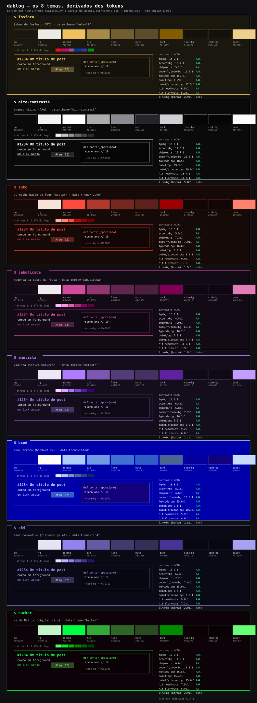

# Os 8 temas



O `swatches.svg` acima é **gerado**, não desenhado: `tools/theme-swatches.py` reimplementa
em Python as mesmas fórmulas de cor do CSS (`color-mix(in oklab …)`, `oklch(from …)`), então
o que você vê é o que o browser vai renderizar. Se um token mudar no `tokens.css`, mude
também na ferramenta — senão a folha passa a mentir.

```
just swatches      # regenera o SVG e mede o contraste. Falha se um par de TEXTO reprovar.
```

---

## A regra: um tema declara três cores

Um tema sobrescreve **só o trio mestre** — `--background`, `--foreground`, `--accent`. Todo
o resto (`--accent-dim/line/mute/dark`, `--chip-text`, `--sidebar-bg`, `--code-bg` e as 6
faixas do logo) **recalcula sozinho**, porque as fórmulas em `tokens.css` releem o `--accent`
vencedor no seletor do tema.

É por isso que adicionar um tema custa três linhas:

```css
:root[data-theme="novo"] {
    color-scheme: dark;
    --background: #…;
    --foreground: #…;
    --accent: #…;
}
```

As misturas são feitas em **OKLab**, não em sRGB: misturar em sRGB passa por tons lamacentos
e a matiz do tema se perde pelo caminho.

### As duas exceções

**`high-contrast` fixa os derivados em hex.** Com accent branco sobre fundo quase-preto, a
mistura cairia em cinzas de baixo contraste — sobretudo o chip. A fórmula que serve sete
temas quebra no caso extremo, então ali os valores são cravados à mão.

**`bsod` descola o `--code-bg` do `--sidebar-bg`.** Nos outros temas o azul não existe; ali
o `#0000aa` é vivo e saturado, e um bloco de código inteiro sobre ele vibra. É o único
motivo pelo qual o token `--code-bg` existe separado.

---

## As cores

`default` é o `:root` base e **nunca seta `data-theme`** — por isso ele é o único que
mantém a TV do logo em arco-íris; qualquer tema nomeado cai num degradé monocromático do
seu accent.

As três primeiras colunas são **declaradas**; as demais são **derivadas** (exceto no
`high-contrast`, onde são fixas).

| tema | `--background` | `--foreground` | `--accent` | `--accent-dim` | `--accent-line` | `--accent-mute` | `--accent-dark` | `--sidebar-bg` | `--code-bg` |
|---|---|---|---|---|---|---|---|---|---|
| **fosforo** *(default)* | `#1a170f` | `#eceae5` | `#eec35e` | `#a78a45` | `#715e31` | `#5c4d2a` | `#845c00` | `#14110a` | `#14110a` |
| **alto-contraste** | `#0a0a0b` | `#f4f4f5` | `#ffffff` | `#e6e6e9` | `#8a8a91` | `#26262a` | `#cfcfd4` | `#050506` | `#050506` |
| **zuko** | `#160a08` | `#f5e3da` | `#ff4b3e` | `#b1382d` | `#752820` | `#5e211b` | `#9d0000` | `#120605` | `#120605` |
| **jabuticaba** | `#120a14` | `#f0e9ee` | `#d24a9e` | `#923670` | `#61264d` | `#4e203f` | `#7d0055` | `#0e0610` | `#0e0610` |
| **ametista** | `#140e1c` | `#ece6f5` | `#b07bff` | `#7c57b3` | `#543b79` | `#453162` | `#5f20a1` | `#0f0917` | `#0f0917` |
| **bsod** | `#0000aa` | `#ffffff` | `#aecbff` | `#7199e8` | `#416fd3` | `#2e5dca` | `#4b6492` | `#04009c` | `#12007d` |
| **c64** | `#0a0a16` | `#e6e3f5` | `#8f84ec` | `#635ba4` | `#403c6d` | `#333058` | `#463393` | `#070712` | `#070712` |
| **hacker** | `#0d0208` | `#bff5c8` | `#00ff41` | `#32a836` | `#306529` | `#2b4c23` | `#008b00` | `#0a0106` | `#0a0106` |

### De onde vem cada um

| tema | referência | nota |
|---|---|---|
| fosforo | âmbar de fósforo dos monitores CRT | o default |
| alto-contraste | branco máximo | todos os pares ≥ 7:1 (AAA) |
| zuko | vermelho da Nação do Fogo (*Avatar*) | |
| jabuticaba | magenta da casca da fruta | |
| ametista | violeta (*Steven Universe*) | |
| bsod | a tela azul do Windows 9x | o único com fundo **azul** — a piada toda |
| c64 | azul do Commodore 64 | o azul autêntico (`#7c70da`) dava 2.3:1; o VIC-II era para CRT. Clareado para `#8f84ec` |
| hacker | verde Matrix (*digital rain*) | |

### As faixas do logo

A TV do logo tem 6 faixas. No `default` elas são o arco-íris da identidade:

| | | | | | |
|---|---|---|---|---|---|
| `#E5141E` | `#D60270` | `#9B4F96` | `#0038A8` | `#3E31A2` | `#008F11` |
| atari | rosa | roxo | azul | c64 | hacker |

Em **qualquer** tema nomeado, uma regra única as substitui por um degradé do accent —
luminosidade fixa em `0.96 / 0.82 / 0.67 / 0.52 / 0.40 / 0.29`, matiz e croma preservados.
Seis tons do accent, claro para escuro, imitando a iluminação de um CRT colorido. Nenhum
tema declara `--stripe-*`: a recoloração é automática.

No alto-contraste, o accent é branco (croma ≈ 0), então o degradé cai em cinzas de graça.

---

## Contraste

Os pares medidos e o alvo de cada um. **Alvo 4.5:1** vale para texto (WCAG 1.4.3) e
**reprova** o `just swatches`. A borda é medida mas não é gate: contorno decorativo não está
sujeito a mínimo de contraste, e um gate que mente ensina a ignorá-lo.

| par | o que é | alvo |
|---|---|---|
| `fg/bg` | texto do corpo | 4.5 |
| `accent/bg` | link, título, prompt | 4.5 |
| `chip/mute` | texto do chip de tag em repouso | 4.5 |
| `code-fn/code-bg` | nome de função no bloco de código | 4.5 |
| `fg/code-bg` | corpo do código | 4.5 |
| `dim/sidebar-bg` | `--accent-dim` usado como texto | 4.5 |
| `line/bg` | borda dos painéis | informativo |

### A armadilha do `--accent-dim`

**`--accent-dim` não serve como cor de texto.** Ele mistura o accent com o *background* —
isto é, escurece — então sobre um fundo escuro ele **afunda**. Medido sobre `--sidebar-bg`:

| tema | contraste | |
|---|---|---|
| jabuticaba | **2.84:1** | reprova |
| zuko | **3.30:1** | reprova |
| c64 | **3.40:1** | reprova |
| ametista | **3.61:1** | reprova |
| bsod | 5.00:1 | passa |
| fosforo | 5.71:1 | passa |
| hacker | 6.66:1 | passa |
| alto-contraste | 16.36:1 | passa (é fixo, não derivado) |

Isso já mordeu três vezes — no bloco de código, no contador da galeria e no tempo do áudio.
Nos três casos a correção foi a mesma: **misturar com o `--foreground`** (que clareia) em vez
do background.

```css
/* errado, como TEXTO: */  color: var(--accent-dim);
/* certo:              */  color: color-mix(in oklab, var(--accent) 85%, var(--foreground));
```

O `--accent-dim` continua legítimo para o que ele foi feito: superfícies e traços quietos —
não texto.

**Nada disso aparece no Lighthouse**, porque ele só audita o tema ativo. Um `a11y 100` não
diz nada sobre os outros sete. É essa a lacuna que o `just swatches` fecha.
